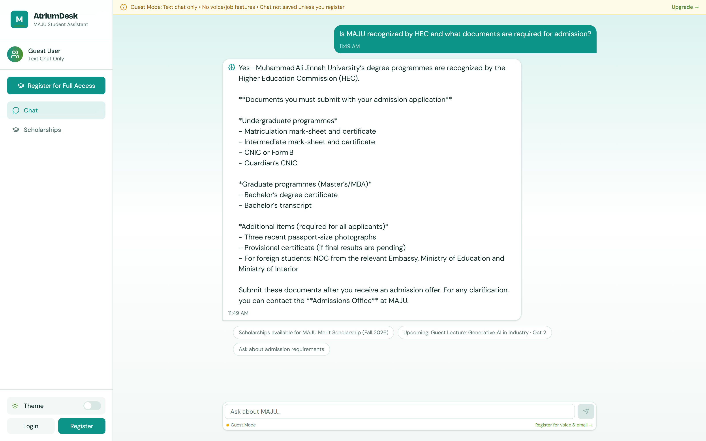

# AtriumDesk 🎓
### AI student assistant & university help desk — a multi-tenant SaaS any university can join


AtriumDesk is a full-stack AI-powered platform that consolidates university student services into one intelligent system, built database-per-tenant so any university can be onboarded. At its core is a smart chatbot (RAG over each tenant's own scraped website content) with voice input support — making university help accessible to every student. The client is a responsive web app with an installable, offline-capable PWA shell.

> **Note:** AtriumDesk is a university-agnostic product and is not affiliated with, or officially launched for, any specific institution. Muhammad Ali Jinnah University (MAJU) is a *pilot / prospective tenant* — sample data was shared for evaluation, and they may onboard as a tenant in future.

<p align="center">
  
</p>

---

## ✨ Features

### 🎓 Student Portal
| Module | Status | Description |
|--------|--------|-------------|
| **Guest Page** | ✅ | Public admissions assistant for applicants: chat, the university's own scholarships and campus events. Each university has its own link (`/?u=<id>`) and a one-tag **website widget** (`/widget.js`) |
| **Auth** | ✅ | Register / login with a university email, OTP verification, password recovery |
| **AI Chatbot** | ✅ | Answers university queries via RAG over the tenant's own website; source links under confident answers; 👍/👎 on every answer (a 👎 lands in the failed-question log); one-click "file a query" handoff with the transcript; starter questions the university chooses; rename / clear conversations; voice input; profanity filter with admin flagging. A message suggesting self-harm gets a fixed support reply with the university's own counselling contacts, never a model answer |
| **Issue Tracker** | ✅ | Submit and track support requests with attachments; the form offers an existing answer before you file; replying to a resolved issue reopens it; rejection reasons shown; resolved issues auto-close after 7 days; in-app bell + email notifications |
| **Job Portal** | ✅ | Scraped + manually-entered listings, hard-rule + embedding-based matching, skill-gap analysis against an uploaded CV; **"Alert me"** saves a search and emails new matches |
| **Scholarship Portal** | ✅ | Scraped + manually-entered listings, CGPA-aware matching, cached LLM match explanations; **"Alert me"** on the study-abroad search |
| **Events** | ✅ | Manual-entry campus events with save/reminder support, calendar (.ics / Google) and WhatsApp sharing; **RSVP** with limited places, a waitlist that moves up automatically, and a door check-in code |
| **Office queue** | ✅ | Join an office's walk-in line (Finance, Registrar…) from the phone: ticket number, people ahead, rough wait, and a notification when you're next and when it's your turn |
| **Saved & Applications** | ✅ | Saved scholarships/jobs/events with an application tracker (preparing → applied → interviewing → offer), notes, documents checklist, deadline reminders |
| **Profile Page** | ✅ | Unified academic/career/study-abroad/events profile (incl. department), auto-filled from CV parsing or a tenant's student-email pattern; digest settings; search alerts; **browser notifications** per device; download my data / delete my account |

### 🏢 Staff Portal (Department-scoped)
| Module | Status | Description |
|--------|--------|-------------|
| **Dashboard** | ✅ | Open / In Progress / Resolved-this-week cards, 7-day trend chart, avg first-response time, recent issues, your own reply count |
| **Department Inbox** | ✅ | Only your department's issues; per-status counts, escalated-only and assigned-to-me filters; 20s polling |
| **Issue Detail** | ✅ | Full thread with student info and attachments; assign/reassign; **internal notes** only staff see; **transfer** to the right department; department **saved replies**; **"Draft a reply"** from the knowledge base (edited before sending) |
| **Walk-in Queue** | ✅ | Open/close the department's queue, call the next student to your counter (they're notified), mark served / no-show, today's served count and average wait |
| **Status Management** | ✅ | Update status (Pending → In Progress → Resolved → Closed); student notified by bell + email |
| **Reply System** | ✅ | Threaded replies to students; notification fires on every reply |

### ⚙️ Admin Panel
| Module | Status | Description |
|--------|--------|-------------|
| **Dashboard** | ✅ | Stat cards (students/staff/admins/departments/issues/chats/flagged) + 7-day issue trend + recent signups + **assistant card** (questions answered, confident share, helpful rate, chat-to-ticket handoffs, answers given on the issue form, most-asked gaps) |
| **Users** | ✅ | List students with search and filters (blocked / flagged); detail drawer with issues, chats, flags; block/unblock with confirm |
| **Staff** | ✅ | Create staff with an auto-generated address on the university's staff email pattern + 12-char password (shown once + emailed); filter by department; deactivate |
| **Departments** | ✅ | Create / edit / soft-deactivate; first-reply target (SLA hours, optionally counted in working hours only) and who escalations go to; turn on the walk-in queue |
| **Failed Questions** | ✅ | Questions the bot couldn't answer well (low confidence or rated 👎), grouped with counts and the answer given — answer them straight into the knowledge base |
| **Query** | ✅ | Cross-department issue analytics — top categories, by-department, avg resolution time, filterable table, read-only detail |
| **Data (Vector DB)** | ✅ | Direct-to-Python CRUD on the chatbot knowledge base; edit/add chunks; upload PDF / DOCX / TXT with auto chunking + embedding |
| **Logs & Activity** | ✅ | Three tabs: admin action audit (with redacted payload), login events (success + failures), chat browser with flagged-student filter |
| **Content Management** | ✅ | Manage scholarship/job/event sources, review scraped listings, event RSVPs (attendees + check-in), self-service chatbot knowledge-base website scraping with a weekly/fortnightly/monthly refresh |
| **System Health** | ✅ | One-screen manual health check pinging MongoDB, ChromaDB, and the active LLM provider — meant to be run right before a demo/exam |
| **Settings** | ✅ | Branding (name, logo, colour), email domains and patterns, OTP email account, retrieval tuning, starter questions, counselling contacts for the wellbeing reply, working hours, plus the guest link and website-widget snippet to share |

### 🧑‍✈️ Super Admin (Platform)
| Module | Status | Description |
|--------|--------|-------------|
| **Dashboard / Tenants / Usage** | ✅ | Cross-tenant KPIs, tenant create/suspend/edit/billing, per-tenant analytics, real LLM token/request usage tracking |
| **Impersonation** | ✅ | Time-limited login-as-Administrator for support, fully attributed in that tenant's own audit log |

---

## 🛠️ Tech Stack

```
client/    →  React 19 + Redux Toolkit + Tailwind + Vite (Student, Staff, Admin & Super Admin UI, PWA)
server/    →  Node.js / Express + MongoDB / Mongoose — one PlatformDB (tenant registry, Super Admin)
               + one MongoDB database per tenant (models/registry.js)
python/    →  FastAPI + ChromaDB + sentence-transformers — one Chroma collection per tenant
```

**Key libraries:** `recharts` (admin/staff dashboards), `react-markdown`, `react-hot-toast`, `lucide-react`, `multer`, `nodemailer` (any SMTP relay — Gmail, Brevo, Resend…), `web-push` (browser notifications), `express-rate-limit`, `pyjwt`, `pypdf`, `python-docx` (chunking is a hand-rolled heading-anchored packer in `scraper.py`, not a third-party splitter).

---

## 🚀 Getting Started

### Prerequisites
- Node.js 20+ (the production image uses Node 22)
- Python 3.12
- MongoDB — a local server or an Atlas URI
- At least one LLM key (Groq or Gemini), or a local Ollama

### Installation

```bash
git clone https://github.com/ibrahim123-sia/AtriumDesk.git
cd AtriumDesk

# Web client and API server
cd client && npm install
cd ../server && npm install

# AI service, in a virtual environment
cd ../python
python -m venv .venv
source .venv/bin/activate        # Windows: .venv\Scripts\activate
pip install -r requirements.txt
```

### Environment variables

Each service has a `.env.example` listing every variable the code reads. Copy it and fill in real values:

```bash
cp server/.env.example server/.env
cp python/.env.example python/.env
cp client/.env.example client/.env
```

Those files are the source of truth; the summary below is a quick overview.

`server/.env` (highlights)
```
MONGODB_URI=...                          # one shared cluster; each tenant gets its own database on it
PLATFORM_DB_NAME=AtriumDeskPlatform      # tenant registry + Super Admin users
JWT_SECRET=<long-random-string>          # tenant-user JWTs
PLATFORM_JWT_SECRET=<long-random-string> # Super Admin JWTs — must differ from JWT_SECRET
INTERNAL_SECRET=<long-random-string, must match python/.env>
FIELD_ENCRYPTION_KEY=<32-byte-hex>       # encrypts a tenant's own SMTP app password at rest
SUPERADMIN_EMAIL / SUPERADMIN_NAME / SUPERADMIN_PASSWORD   # seeded on first run
DEFAULT_TENANT_SLUG=maju                 # which tenant guest/legacy traffic resolves to
EMAIL_USER / EMAIL_PASS                  # platform-default Gmail SMTP fallback
SMTP_HOST / SMTP_PORT / SMTP_SECURE      # …or any other SMTP relay (e.g. smtp-relay.brevo.com:587)
SMTP_USER / SMTP_PASS / EMAIL_FROM       # relay login + sender address (a tenant's own SMTP in Settings wins)
VAPID_PUBLIC_KEY / VAPID_PRIVATE_KEY     # browser notifications — `npx web-push generate-vapid-keys`, keep them
VAPID_SUBJECT=mailto:support@example.edu # (empty = push off; email + in-app still work)
PYTHON_BACKEND_URL=http://localhost:8000
```

`python/.env` (highlights)
```
JWT_SECRET=<same value as server/.env>
INTERNAL_SECRET=<same value as server/.env>
NODE_INTERNAL_URL=http://localhost:3000
USE_LOCAL_LLM=false                      # true = Ollama; false = the cloud order below
CLOUD_LLM_ORDER=groq,gemini              # failover order when USE_LOCAL_LLM is false
GROQ_API_KEY=...                         # GROQ_API_KEY_2 / _3 for dual-key failover
GEMINI_API_KEY=...
# Ollama (local, only used when USE_LOCAL_LLM=true) — start `ollama serve` first
OLLAMA_HOST=http://localhost:11434
OLLAMA_MODEL=llama3.2:3b
OLLAMA_MODEL_SIZE=3b
OLLAMA_TIMEOUT=300
# Whisper (local STT, faster-whisper)
WHISPER_MODEL=base
WHISPER_DEVICE=cpu
WHISPER_COMPUTE_TYPE=int8
```

`client/.env`
```
VITE_SERVER_URL=http://localhost:3000
VITE_PYTHON_URL=http://localhost:8000
# VITE_SITE_URL=https://atriumdesk-web.<you>.workers.dev   # the web client's own address, for search engines
```

### Seed the platform + first tenant

```bash
cd server
node scripts/seedTenant.js   # idempotent — creates/updates the Tenant registry row, that tenant's
                              # Administrator, and the Super Admin user from the env vars above
```

### Running locally

```bash
# Start backend  (from /server)
npm run server          # → http://localhost:3000

# Start AI service  (from /python)
python run.py server    # → http://localhost:8000

# Start frontend  (from /client)
npm run dev             # → http://localhost:5173
```

Log in as the admin you seeded, create departments + staff from the admin panel, then register a student through the UI to exercise the full flow. A guest can open a specific university's assistant with `http://localhost:5173/?u=<tenant slug>`.

### Tests

```bash
cd server && npm test                  # node --test (113 tests) — matching, CGPA conversion, URL/SSRF guard,
                                       # scheduler, working hours, wellbeing, skill gaps, department suggestion,
                                       # file store, tenant isolation, and service-desk integration tests
                                       # (issues, guests, data rights, RSVPs, alerts, push, walk-in queue)
cd client && npm run lint && npm run build
cd python && python -m pytest          # AI-service unit tests in python/tests (keyword matcher, rate-limit parsing, scraper hash)
cd python/eval && python retrieval_eval.py   # golden set vs retrieved context only — no LLM calls
cd python/eval && python eval.py       # golden-set RAG evaluation against a running AI service (needs INTERNAL_SECRET)
```

The golden set (`python/eval/golden_set.json`) is the regression check for any change to the RAG prompt, retrieval or chunking — run it before and after. It can set `user_type` per case (guest or student).

---

## ☁️ Deploying to Cloudflare

Everything runs on Cloudflare; MongoDB stays on Atlas (one cluster, every tenant's database on it).

| Part | Runs on | Config |
| --- | --- | --- |
| Web client | Workers static assets (`atriumdesk-web`), SPA fallback | `client/wrangler.jsonc` |
| API server (`server/`) | Cloudflare Container `ApiServer` — `basic`, 1 GiB | `server/Dockerfile` |
| AI service (`python/`) | Cloudflare Container `AiService` — `standard-1`, 4 GiB; models + Chromium baked into the image | `python/Dockerfile` |
| Front door | Worker `atriumdesk-api`: `/uploads/*` → R2, `/ai/*` → AI service, everything else → API server | `cloudflare/` |
| Files | R2 bucket `atriumdesk-uploads`: uploads, the knowledge-base snapshot and its daily backups | — |
| Background jobs | Cron Trigger every hour → `POST /api/admin/internal/run-jobs` | `cloudflare/wrangler.jsonc` |

Containers sleep when idle and their disks are wiped on every sleep or redeploy, so:

- **Uploads** (attachments, avatars, tenant logos, activity images) are copied to R2 as they are saved (`server/services/fileStore.js`), and the Worker serves `/uploads/*` from the bucket.
- **The knowledge base** (ChromaDB — every tenant's collection) is restored from R2 on startup and saved back after changes (`python/kb_snapshot.py`); the daily backup goes to `kb/backups/` in the bucket, keeping 14.
- **Background jobs** don't use in-process timers (`DISABLE_SCHEDULERS=true`): the hourly cron runs SLA escalation, wakes the AI service only when a recurring source is due, and runs the daily jobs at their hour in `TZ` (backup 1am, reminders 2am, listing expiry 3am, digests 6am).
- All of this is a no-op without the `R2_*` / `DISABLE_SCHEDULERS` settings, so local development is unchanged.

**You need:** the Workers Paid plan ($5/month, required for Containers) with R2 enabled, a MongoDB Atlas cluster that accepts connections from anywhere (`0.0.0.0/0` — containers have no fixed IP), and Docker — or the **Deploy to Cloudflare** GitHub Actions workflow, whose runners have Docker.

```bash
# 1. Login + bucket (once)
cd cloudflare && npm install
npx wrangler login
npx wrangler r2 bucket create atriumdesk-uploads

# 2. Edit cloudflare/wrangler.jsonc → vars: PUBLIC_URL, CLIENT_URL, R2_ACCOUNT_ID

# 3. Secrets (once; values from server/.env and python/.env).
#    R2_ACCESS_KEY_ID / R2_SECRET_ACCESS_KEY: dashboard → R2 → Manage API tokens
#    → "Object Read & Write" on atriumdesk-uploads.
for s in MONGODB_URI JWT_SECRET PLATFORM_JWT_SECRET INTERNAL_SECRET FIELD_ENCRYPTION_KEY \
         R2_ACCESS_KEY_ID R2_SECRET_ACCESS_KEY GROQ_API_KEY GEMINI_API_KEY EMAIL_USER EMAIL_PASS; do
  npx wrangler secret put $s
done                                  # optional: GROQ_API_KEY_2, GROQ_API_KEY_3

# 4. Backend: Worker + both containers (Docker must be running)
npm run deploy

# 5. Seed R2 with what only exists locally (R2_* set in the environment)
cd ../python && python run.py push-kb        # local chroma_db/ → the AI service's knowledge base
cd ../server && node scripts/pushUploads.js  # local uploads/ → the bucket

# 6. Web client
cd ../client
VITE_SERVER_URL=https://atriumdesk-api.<you>.workers.dev \
VITE_PYTHON_URL=https://atriumdesk-api.<you>.workers.dev/ai \
VITE_SITE_URL=https://atriumdesk-web.<you>.workers.dev \
npm run build && npx wrangler deploy
```

Without Docker, use **Actions → Deploy to Cloudflare → Run workflow** (`.github/workflows/deploy-cloudflare.yml`) for steps 4 and 6 — it needs the repository secrets `CLOUDFLARE_API_TOKEN` and `CLOUDFLARE_ACCOUNT_ID` and the repository variables `VITE_SERVER_URL` / `VITE_PYTHON_URL` (plus, optionally, `VITE_SITE_URL` — see below). A new database is seeded from your machine against Atlas with `node scripts/seedTenant.js` (in `server/`). `npm run logs` (in `cloudflare/`) tails the Worker; the containers' logs are in the dashboard under Workers → `atriumdesk-api` → Containers.

---

## 💬 Website widget

Add the admissions assistant to a university's own website with one tag
(the exact snippet, with your address and university id, is in
**Admin → Settings → Share your assistant**):

```html
<script src="https://<your AtriumDesk address>/widget.js" data-university="<university id>" async></script>
```

Optional `data-label="Ask us"` and `data-color="#0D9488"`. It adds a chat button
that opens the guest assistant (`/embed`) in a panel. `/embed` is the only page
other sites may frame (see `client/public/_headers`).

---

## 🔎 Search engines and link previews

- Every public page (guest assistant, scholarships, campus life, login, sign-up, privacy, terms) has its own title,
  description and canonical link; signed-in pages, `/embed` and `/unsubscribe` are `noindex`
  (`client/src/components/RouteMeta.jsx`, wording in `client/src/utils/seo.js`).
- Shared links show a preview card (`client/public/og-image.png`, Open Graph + Twitter tags in `client/index.html`),
  and the page carries `WebApplication` structured data.
- The build writes `robots.txt` (keeps crawlers out of the signed-in areas) and, when `VITE_SITE_URL` is set to the
  web client's address, `sitemap.xml` plus absolute canonical and preview URLs (`client/vite-plugin-seo.js`).
  After the first deploy, add the site to Google Search Console and submit `/sitemap.xml`.

---

## 📁 Project Structure

```
AtriumDesk/
├── client/                    # React web app — every role, plus the PWA shell
│   ├── public/                # service worker, manifest, website widget (widget.js), _headers, link-preview image
│   ├── vite-plugin-seo.js     # robots.txt, sitemap.xml, canonical + preview URLs at build time
│   └── src/
│       ├── guest/             # public admissions assistant (+ /embed for the widget)
│       ├── student/           # chat, issues, scholarships, jobs, events, saved, office queue
│       ├── staff/             # department dashboard, inbox, issue detail, walk-in queue
│       ├── administrator/     # /admin/* — one university's admin panel
│       ├── platform/          # /platform/* — Super Admin
│       ├── profile/           # unified profile, alerts, notifications, your data
│       ├── auth/  legal/      # login/register/route guards · privacy and terms
│       ├── components/        # sidebar, top navbar, notification bell, layouts
│       ├── redux/slices/      # one slice per area
│       └── utils/             # axios, branding, guest university, push
├── server/                    # Node.js / Express API
│   ├── config/                # shared MongoDB connection + per-tenant databases
│   ├── controllers/           # request handlers, one file per area
│   ├── middlewares/           # auth, roles, staff permissions, audit logging, uploads
│   ├── models/                # per-tenant models (models/registry.js)
│   │   └── platform/          # PlatformDB: Tenant, SuperAdminUser, PlatformAuditLog
│   ├── routes/                # /api/* routers; /api/platform for the Super Admin
│   ├── services/              # matching, scheduler, notify/mailer/push, SLA hours, SSRF guard…
│   ├── scripts/               # seedTenant, backfillListingEmbeddings, pushUploads
│   └── test/                  # node --test unit and integration tests
├── python/                    # FastAPI AI service
│   ├── api.py                 # HTTP endpoints (/ask, knowledge base, scraping, CV parsing…)
│   ├── rag.py                 # RAG pipeline, confidence tiers, LLM failover
│   ├── database.py            # ChromaDB — one collection per tenant, hybrid search
│   ├── scraper.py             # per-tenant website scraper for the knowledge base
│   ├── listing_*.py           # scholarship/job scraping, matching, explanations
│   ├── eval/                  # golden set: retrieval_eval.py, eval.py, golden_set.json
│   └── tests/                 # pytest unit tests
├── cloudflare/                # front-door Worker + container config
├── .github/workflows/         # "Deploy to Cloudflare"
├── AGENTS.md                  # full product spec — source of truth for coding agents
├── LICENSE  SECURITY.md       # licence · how to report a vulnerability
├── .editorconfig  .gitattributes
└── preview.png
```

---

## 📚 Documentation

- **[`AGENTS.md`](AGENTS.md)** — the complete spec: every planning revision, the current answer for each decision area, and Part E, the October 2026 review of the built system. This is the source of truth for AI coding agents and for anything this README leaves open.
- **[`client/README.md`](client/README.md)** — the web client: routes per role, scripts, the PWA and the embed widget.

### Known issues

- "What scholarships does the university offer and how much do they cover?" misses the 100% row of MAJU's scholarship table for everyone (golden cases `*-scholarships-coverage`): the table is split into many small chunks. Needs table-aware chunking and a re-scrape, or an Administrator-written answer.
- The free LLM tiers are small: Groq keys from one organisation share 8,000 tokens/minute (about two answers a minute) and 200,000 tokens/day, and Gemini sometimes answers 503 "high demand". Use keys from different organisations or a paid tier for real traffic.
- Browser notifications need `VAPID_*` keys in the deployment's secrets; changing them later ends every existing subscription.
- Event check-in codes are typed by the person at the door (no QR scanner yet).

---

## 👥 Contributing

Bug reports and suggestions are welcome through GitHub Issues. Please open an issue before starting a pull request, so the change can be agreed first. Security problems go through private reporting instead — see [`SECURITY.md`](SECURITY.md).

---

## 📄 License

Proprietary — © 2026 Syed Ibrahim Ali, all rights reserved. The source is published to be read and evaluated; using, copying or hosting it needs written permission. See [`LICENSE`](LICENSE).

---

<p align="center">Built by <a href="https://github.com/ibrahim123-sia"><b>Syed Ibrahim Ali</b></a> — Full-Stack &amp; AI Engineer</p>
